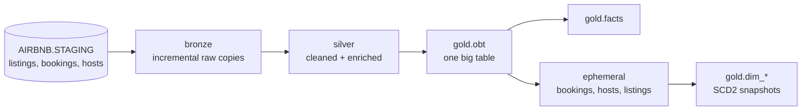

# Airbnb Warehouse Pipeline

A dbt project that turns raw Airbnb listings, bookings and hosts data in Snowflake into an analytics-ready warehouse using a medallion (bronze → silver → gold) architecture.

## Tech stack

- **Snowflake**: data warehouse (database `AIRBNB`)
- **dbt Core** with the **dbt-snowflake** adapter: transformations, snapshots, tests
- **Jinja**: macros and config-driven SQL generation
- **Python 3.12** + **uv**: environment and dependency management

## How it works



### Source
Raw data is expected to already be loaded into `AIRBNB.STAGING.{listings, bookings, hosts}` (declared in `airbnb/models/sources/source.yml`).

### Bronze (`airbnb/models/bronze`)
Incremental tables that copy each staging table as-is. On each run only rows with a `CREATED_AT` newer than the current max are appended.

### Silver (`airbnb/models/silver`)
Incremental tables merged on their primary key (`BOOKING_ID`, `LISTING_ID`, `HOST_ID`) that clean and enrich the data:
- **bookings**: computes `TOTAL_AMOUNT` = nights × amount + cleaning fee + service fee
- **listings**: adds `PRICE_PER_NIGHT_TAG` (`low` / `medium` / `high`)
- **hosts**: normalizes `HOST_NAME` and adds `RESPONSE_RATE_CATEGORY`

### Gold (`airbnb/models/gold`)
- **obt**: one big table joining bookings → listings → hosts. The joins are generated from a Jinja config list.
- **facts**: the numeric measures and keys from `obt`.
- **ephemeral/**: `bookings`, `hosts` and `listings` CTEs carved out of `obt`. They are not materialized and feed the snapshots.

### Snapshots (`airbnb/snapshots`)
`dim_bookings`, `dim_hosts` and `dim_listings` are SCD Type 2 dimensions built with the `timestamp` strategy. Current rows have `dbt_valid_to = 9999-12-31`.

### Macros (`airbnb/macros`)
- `generate_schema_name`: writes models to plain `bronze` / `silver` / `gold` schemas instead of prefixing them with the target schema
- `multiply`: rounded multiplication
- `tag`: buckets a price into `low` / `medium` / `high`

### Tests and analyses
- `airbnb/tests/source_tests.sql`: a singular test that warns on bookings with `booking_amount < 200`
- `airbnb/analyses/`: ad-hoc EDA and Jinja examples (compiled, never run)

## Running it

1. Install dependencies:
   ```sh
   uv sync
   ```
2. Add a Snowflake connection named `airbnb` to `~/.dbt/profiles.yml`.
3. Build everything (models, snapshots and tests in dependency order):
   ```sh
   cd airbnb
   uv run dbt build
   ```
